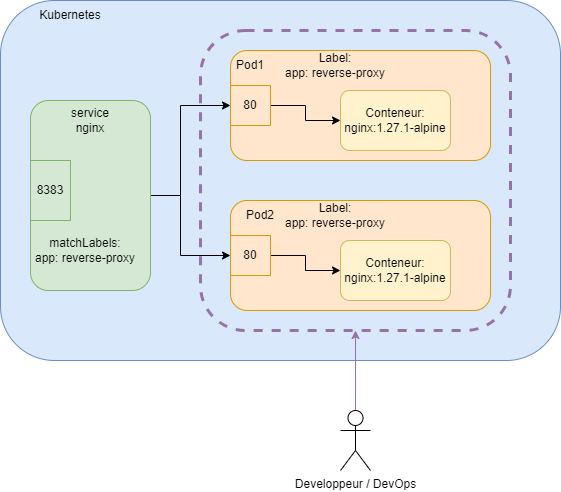
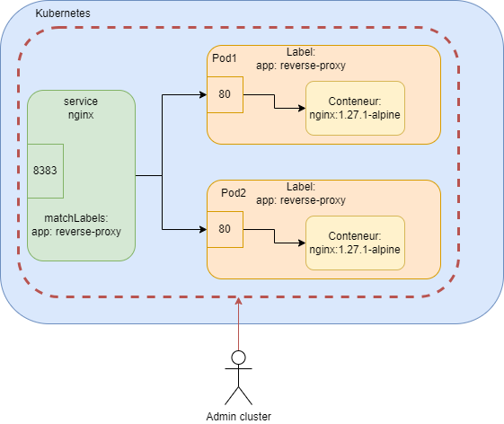

# TP Kubernetes — Partie 1 : comptes rendus et commandes

> J'ai regroupé ici les commandes principales de la partie 1 et les réponses aux questions ❓.
> Toutes les commandes ont été exécutées sur le cluster Minikube de la machine.

J'ai commencé par les namespaces, puis j'ai déployé NGINX dans `front`. Le but était surtout de
vérifier que le Service retrouvait bien les deux pods via le label `app: reverse-proxy`, et que
le port-forward permettait d'atteindre la page par défaut depuis le navigateur.

---

## 1. Pré-requis

```bash
# Démarrer Minikube (le driver Docker doit être lancé)
minikube start --driver=docker

# Vérifier l'état du cluster
minikube status

# Vérifier que kubectl communique bien avec le cluster
kubectl version
```

Résultat attendu pour `minikube status` :

```text
minikube
type: Control Plane
host: Running
kubelet: Running
apiserver: Running
kubeconfig: Configured
```

---

## 2. Namespaces

### Fichiers YAML créés

Les trois namespaces sont définis de façon déclarative (pas avec `kubectl create namespace`) :

| Namespace  | Fichier                              |
|------------|--------------------------------------|
| `front`    | `TP/front/namespace.yml`             |
| `middle`   | `TP/middle/namespace.yml`            |
| `database` | `TP/database/namespace.yml`          |

Contenu type (exemple pour `front`) :

```yaml
apiVersion: v1
kind: Namespace
metadata:
  name: front
  labels:
    name: front
```

### Commandes

```bash
# 1) Avant de déployer : liste des namespaces déjà présents (capture n°1)
kubectl get namespaces

# 2) Déployer les 3 namespaces
kubectl apply -f TP/front/namespace.yml
kubectl apply -f TP/middle/namespace.yml
kubectl apply -f TP/database/namespace.yml

# 3) Après déploiement : on doit voir front, middle et database (capture n°2)
kubectl get namespaces

# 4) Visualiser la configuration d'un namespace
kubectl describe namespace front
```

📸 **Capture n°1 — avant création** : [`img/partie1-namespaces-avant.png`](img/partie1-namespaces-avant.png)  
📸 **Capture n°2 — après création** : [`img/liste_namespace_TP_partie1.png`](img/liste_namespace_TP_partie1.png)

> Pour la capture « avant », le cluster avait déjà servi aux parties suivantes au moment de la
> rédaction. J'ai donc repris la liste des namespaces système, sans `front`, `middle` ni
> `database` : c'est l'état qu'on avait juste après `minikube start`.

---

## 3. NGINX (reverse proxy)

### Fichiers YAML créés

| Fichier                              | Rôle |
|--------------------------------------|------|
| `TP/front/nginx-deployment.yml`      | Deployment `nginx` : 2 replicas de pods `app: reverse-proxy` |
| `TP/front/nginx-service.yml`         | Service `nginx` : écoute en TCP sur `8383` → `targetPort: 80` |

`nginx-deployment.yml` :

```yaml
apiVersion: apps/v1
kind: Deployment
metadata:
  name: nginx
  namespace: front
spec:
  replicas: 2
  selector:
    matchLabels:
      app: reverse-proxy
  template:
    metadata:
      labels:
        app: reverse-proxy
    spec:
      containers:
        - name: nginx
          image: nginx:1.27.1-alpine
          ports:
            - containerPort: 80
              protocol: TCP
```

`nginx-service.yml` :

```yaml
apiVersion: v1
kind: Service
metadata:
  name: nginx
  namespace: front
spec:
  selector:
    app: reverse-proxy
  ports:
    - name: http
      protocol: TCP
      port: 8383
      targetPort: 80
```

### Déploiement dans le namespace `front`

```bash
# Les manifestes contiennent déjà `namespace: front`,
# on peut aussi le préciser avec -n pour être explicite.
kubectl apply -n front -f TP/front/nginx-deployment.yml
kubectl apply -n front -f TP/front/nginx-service.yml

# Attendre que le déploiement soit terminé
kubectl rollout status deployment/nginx -n front
```

Résultat :

```text
deployment "nginx" successfully rolled out
```

### ❓ Question 4 — Quelles sont les 2 commandes utilisées pour vérifier les events et le démarrage des pods/conteneurs ?

```bash
# 1) Voir les events du namespace
kubectl get events -n front --sort-by=.lastTimestamp

# 2) Voir l'état des pods (READY / STATUS / RESTARTS)
kubectl get pods -n front
```

Pour entrer dans le détail des conteneurs d'un pod, on peut compléter avec :

```bash
kubectl describe pod <nom_du_pod> -n front
```

Résultat observé :

```text
NAME                     READY   STATUS    RESTARTS   AGE
nginx-5d68b47d97-5zxnz   1/1     Running   0          ...
nginx-5d68b47d97-zkf5s   1/1     Running   0          ...
```

Les events confirment le bon déroulement : `ScalingReplicaSet`, `Scheduled`, `Pulling`,
`Pulled`, `Created`, `Started`.

### Port-forward et test navigateur

```bash
# Redirige le port local 8080 vers le port 8383 du Service nginx
kubectl port-forward -n front svc/nginx 8080:8383
```

Puis ouvrir <http://localhost:8080> : la page par défaut de NGINX s'affiche
(`Welcome to nginx!`).

📸 Capture : [`img/partie1-nginx.png`](img/partie1-nginx.png)

Vérification possible en ligne de commande :

```bash
curl -I http://localhost:8080
# HTTP/1.1 200 OK
```

### ❓ Question 7 — À quoi correspondent les pointillés violets ?



Les pointillés violets délimitent le **Deployment** (et son `ReplicaSet`) `nginx`.

- Le Deployment est l'objet qui décrit l'état désiré : **2 réplicas** de pods ayant le label
  `app: reverse-proxy`.
- Il crée et supervise les pods `Pod1` et `Pod2` ; si un pod meurt, le Deployment/ReplicaSet
  en recrée un automatiquement pour conserver 2 réplicas.
- Le développeur/DevOps (personnage en bas) agit sur le **Deployment**, pas directement sur les
  pods : les pods sont éphémères, le Deployment est l'abstraction stable.
- Le Service, lui, est à l'extérieur de ces pointillés : il ne « possède » pas les pods, il les
  sélectionne simplement via `matchLabels: app: reverse-proxy` pour leur envoyer le trafic.

### ❓ Question 8 — À quoi correspondent les pointillés rouges ?



Les pointillés rouges délimitent le **namespace `front`** : c'est le périmètre logique qui
regroupe toutes les ressources de la partie front, à savoir le `Service nginx` et le
`Deployment nginx` (donc ses pods).

- Un namespace sert à **isoler** les ressources (front / middle / database) : noms, droits,
  quotas, réseau, etc.
- L'« Admin cluster » (personnage en bas) administre ce namespace : il a une vision
  cluster-wide, contrairement au développeur qui travaille dans son namespace.
- Le Service et les pods doivent être dans le **même namespace** pour que la sélection par
  label fonctionne ; c'est pour cela que les deux manifestes déclarent `namespace: front`.

> À retenir : pointillés violets = **Deployment** (gestion des réplicas de pods) ;
> pointillés rouges = **Namespace** (périmètre d'isolation contenant le Service et le Deployment).

---

## 4. Récapitulatif des commandes principales

```bash
# Cluster
minikube start --driver=docker
minikube status
kubectl version
kubectl get nodes

# Namespaces
kubectl apply -f TP/front/namespace.yml
kubectl apply -f TP/middle/namespace.yml
kubectl apply -f TP/database/namespace.yml
kubectl get namespaces
kubectl describe namespace front

# Déploiement NGINX
kubectl apply -n front -f TP/front/nginx-deployment.yml
kubectl apply -n front -f TP/front/nginx-service.yml
kubectl rollout status deployment/nginx -n front

# Vérifications
kubectl get pods -n front
kubectl get events -n front --sort-by=.lastTimestamp
kubectl describe pod <nom_du_pod> -n front
kubectl get svc -n front
kubectl get all -n front

# Accès depuis le PC
kubectl port-forward -n front svc/nginx 8080:8383
# puis http://localhost:8080
```

---

## 5. Livrables de la partie 1

- [x] 3 fichiers YAML de namespaces : `TP/front/namespace.yml`, `TP/middle/namespace.yml`, `TP/database/namespace.yml`
- [x] 2 fichiers YAML NGINX : `TP/front/nginx-deployment.yml`, `TP/front/nginx-service.yml`
- [x] Liste des commandes utilisées (ce document)
- [x] Captures :
  - `img/partie1-namespaces-avant.png` (namespaces avant création)
  - `img/liste_namespace_TP_partie1.png` (namespaces après création)
  - `img/partie1-nginx.png` (page NGINX)
- [x] Réponses aux questions 4, 7 et 8 (ce document)

---

## 6. Ce que j'ai retenu

Le plus simple dans cette partie, c'est finalement la création des namespaces : trois petits
fichiers YAML, et `kubectl apply` fait le reste. Le point un peu piégeux, c'est de penser à
mettre le `namespace` dans les manifestes NGINX : sinon les ressources partent dans `default` et
le Service ne trouve pas les bons pods.

J'ai aussi vérifié le port-forward deux fois : une fois avec `curl -I` pour être sûr du code
HTTP, et une fois dans le navigateur pour la capture. C'est bête, mais ça permet de distinguer
« le pod tourne » de « le service répond vraiment ».
